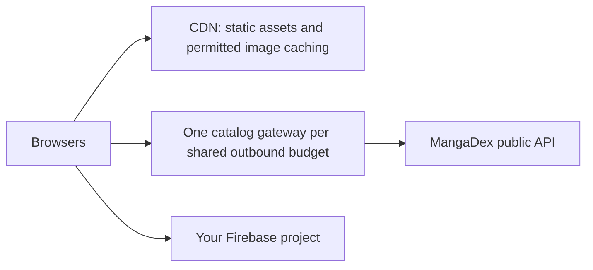

# Capacity testing and the path to 1,000 concurrent users

The repository includes a repeatable **local catalog API load test**, not a production capacity guarantee. A thousand people reading shared, cached content is a different workload from a thousand people requesting unrelated, uncached chapters.

See the [recorded local capacity results](CAPACITY-RESULTS.md) for the measured 1,000-client run, including the successful soak and intentional overload failures.

## Architecture



Use `npm run build && npm start` for the persistent Express gateway. Send all catalog traffic through that gateway. The application uses the MangaDex domain, not a pinned IP address. Rotating or collecting IP addresses does not replace caching or upstream permission for more traffic.

The gateway currently provides:

- A fixed HTTPS upstream and an allowlist of the public reader endpoints.
- Normalized query keys and one in-flight upstream request per identical key.
- An LRU cache bounded to 256 entries and 32 MiB of response bodies.
- Metadata freshness of 60 seconds, followed by up to 15 minutes of stale service with background refresh. Stale responses carry `X-Catalog-Cache: STALE` and `Cache-Control: no-store`.
- Chapter image-server lookup freshness of at most 5 seconds, with **no stale fallback**, because image-server addresses can expire.
- At least 275 ms between upstream starts, and at least 1,550 ms between chapter image-server lookup starts. No more than four active upstream requests.
- At most 32 pending distinct requests, 2,000 followers per key, a five-second queue deadline, a 15-second upstream timeout and a 10 MiB response limit.
- A gateway-wide pause on upstream `429` or `403`, honoring `Retry-After` or MangaDex's epoch header, with a 60-second fallback. It does not automatically retry failed upstream calls. Saturated or paused cold requests receive `503` and `Retry-After`.

The official [MangaDex limitations](https://api.mangadex.org/docs/2-limitations/) document an approximate allowance of five requests per second per IP and 40 chapter image-server lookups per minute. The conservative spacing above leaves some margin, but cannot account for other software using the same outbound IP.

These safeguards are **in memory, in one process**. They reset on restart. Multiple replicas or serverless instances do not share a cache, queue or cooldown. The Vercel adapter now uses the same protection inside each warm instance, but that is **not a global limiter**. For a scaled Vercel frontend, replace its catalog rewrite with your persistent gateway's HTTPS origin; do not forward directly to MangaDex. If the gateway itself needs replicas, introduce a shared cache and an atomic global scheduler, for example through Redis, and test failover and aggregate outbound limits before enabling them. Redis is not implemented by this change.

Use a CDN for static assets and eligible image responses. The existing image proxy sends cache headers, but actual cache hits, bandwidth, memory and image-host behavior depend on the deployment. Avoid routing every image through a single small Node process without measuring it.

The frontend shares a single library state per signed-in session through `LibraryProvider`. All cards see the same favorite updates; switching users or signing out replaces the session and discards late reads from the previous one. The reader renders one page and preloads only the next two instead of downloading the whole chapter ahead of reading.

## Automated scenarios

```sh
npm run test:load                        # eight scenarios, 1,000 virtual users
npm run test:load -- --users=50          # smaller diagnostic run
npm run test:load:soak                   # eight scenarios plus 60-second warm-home soak
npm run test:load -- --scenario=warm-home-soak --soak-seconds=60 # isolate the soak
```

No extra packages or cloud credentials are required. The runner starts a separate local server process on a random loopback port. It has **no target-URL option**. Its upstream is a synthetic function with enforced global and chapter-lookup quotas; external `fetch` is disabled. No load is sent to MangaDex or Firebase.

| Scenario | Expected result |
| --- | --- |
| Baseline without cache or pacing | Reproduces upstream `429` errors; this is a positive control, not a passing application workload |
| Cold Home | 1,000 clients issue six requests each; all succeed with six upstream calls |
| Warm Home | Same 6,000 requests; all succeed with no new upstream calls |
| Popular reader journey | Six Home requests plus four shared detail/feed/chapter/server lookups per client; 10,000 successful API requests with ten upstream calls |
| Slow upstream | Synthetic 800 ms latency; requests remain coalesced and successful |
| Outage after cache warm-up | Stale metadata remains available while actual background refresh attempts fail |
| Upstream `429` | One upstream call triggers the pause; subsequent cold requests get controlled errors |
| Unique searches | Unique misses overload the finite queue; excess requests get `503`, while health remains available and upstream quotas are respected |
| Optional warm Home soak | 1,000 clients repeat the six-request flow for 60 seconds, with one second of think time after each completed flow |

Each scenario has 1,000 logical clients. The generator's HTTP/1.1 connection pool has at most **1,000 sockets**, retaining up to 1,000 idle connections; requests waiting for a socket still count toward client latency. New and reused connections and detailed transport failures are recorded. Retaining the full pool prevents connection churn from exhausting the load generator's ephemeral ports during the soak; the initial Windows run exposed `EADDRINUSE` with Node's default idle-pool size of 256. No errors are retried or excluded from the gate. See [Node's Agent options](https://nodejs.org/docs/latest-v24.x/api/http.html#new-agentoptions). The reader scenario sends its ten API requests together as a burst and uses shared synthetic titles. It does not render browsers or download chapter images. It is not a model of 1,000 unrelated reading sessions.

The pool uses FIFO scheduling to distribute sustained traffic across its persistent sockets. The runner checks response JSON, statuses, exact cache/coalescing counts, upstream rate, transport errors and health probes during load. The 10-second request-p95 threshold is a generous local regression gate, **not a production latency objective**. The baseline and deliberate overload/cooldown cases explicitly expect errors. A green run means their safeguards behaved correctly, not that every scenario served every user successfully.

The ignored `test-results/load/latest.json` report records environment, scenario outcomes, request/flow p95, throughput, response bytes, server peak RSS, event-loop p99, health latency and upstream counts. The generator and server run on the same computer; operating-system limits, hardware and background work affect these measurements. The Quality workflow runs the eight scenarios and retains this report with other test artifacts.

## Production acceptance before advertising 1,000-user capacity

1. Deploy a staging copy of the actual hosting topology, with synthetic data and a controlled upstream. Verify that every route, including Vercel rewrites, crosses the shared limiter.
2. Replay representative traffic at 50, 100, 250, 500 and 1,000 users. Include the real distribution of repeated versus unique searches/titles, chapter transitions, signed-in operations and image sizes.
3. Measure complete page and image delivery, cache hit ratio, request p95/p99, error rates, upstream starts, queue depth, process memory, CPU, bandwidth, CDN egress and Firebase reads/writes. Compare request p95 below one second for warm metadata and below three seconds for cold metadata as initial staging goals; tune these goals to the product and measured network.
4. Include a longer soak, upstream outage, `429`, cache expiration, deploy/restart and gateway failover. Check that a cold restart does not violate the aggregate IP budget.
5. Use the Firestore emulator for repeatable authorization tests; separately validate authorized staging sign-in and actual billing metrics. The [Firestore free quota](https://firebase.google.com/docs/firestore/quotas) is per project and operation, not per API key or simultaneous user.
6. If a realistic uncached workload needs more than the upstream permits, change the workload through permitted caching/prefetching or obtain higher allowance/use a provider authorized for that volume. A larger server alone cannot remove an external quota.

The current automated evidence covers the local catalog gateway and frontend regressions. It does not certify production hosting, real Google OAuth at scale, Firestore billing, image transfer, CDN effectiveness or third-party uptime.
